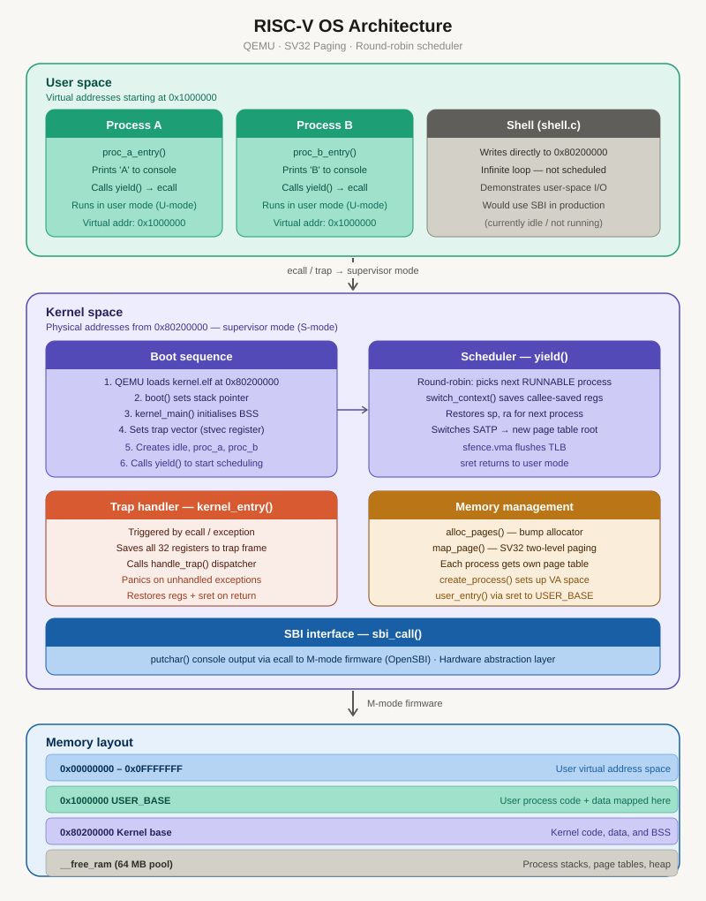

# OS: small kernels from scratch

Operating system experiments for **RISC-V** and **x86**, written in C, C++ and Assembly and run in QEMU.
The goal is to understand what sits underneath every program: booting, traps, virtual memory, processes,
system calls and files, by building each piece by hand.

| Directory | Target | Language | What it is |
|---|---|---|---|
| [`RISC-V_OS/`](RISC-V_OS/) | 32-bit RISC-V (QEMU `virt`) | C | The main kernel: paging, processes, user mode, syscalls and a small file layer |
| [`Joe'sOS/`](Joe'sOS/) | i386 | C++, NASM | Bootable kernel with interrupts, timer, keyboard, a shell and a process table |
| [`OSx86/`](OSx86/) | i386 | C, NASM | First step: a boot sector that loads a C kernel and writes to VGA memory |
| [`tryinOut/`](tryinOut/) | Linux | C | Small warm-up programs |

## RISC-V_OS

A 32-bit kernel that boots through OpenSBI and runs a user-mode shell.

- **Boot and SBI:** custom entry point and linker script; console output through SBI calls.
- **Trap handling:** a trap entry that saves all registers to a trap frame and dispatches to the kernel.
- **Memory:** a page allocator and **SV32** two-level page tables; each process gets its own address space.
- **Processes:** up to 8 processes, each with its own kernel stack; context switching in assembly and cooperative scheduling with `yield`.
- **User mode:** the shell is a separate binary embedded into the kernel image and started in U-mode.
- **System calls:** 9 syscalls (`putchar`, `getchar`, `exit`, disk read/write, file open/close/read/write).
- **Files:** inodes and file descriptors on a 512-byte-block RAM disk.



A longer write-up is in [`riscv_os_explained.pdf`](RISC-V_OS/riscv_os_explained.pdf).

**Run it** (needs LLVM/clang with RISC-V support and `qemu-system-riscv32`):

```sh
cd RISC-V_OS
./run.sh        # builds the shell and kernel, then boots QEMU
```

Inside the shell: `hello`, `open`, `write`, `read`, `exit`.
`run.sh` uses Homebrew's LLVM path on macOS; on Linux, set `CC=clang` and `OBJCOPY=llvm-objcopy`.

## Joe'sOS (x86)

A 32-bit freestanding C++ kernel packed into a bootable floppy image.

- Boot sector in NASM that loads the kernel and switches to protected mode
- Interrupt descriptor table, PIC remapping and **PIT** timer ticks
- IRQ-driven keyboard input
- A shell with `help`, `about`, `clear`, `echo`, `ps`, `proc`, `spawn`, `kill`, `uptime`, `halt`
- A process table with round-robin scheduling

```sh
cd "Joe'sOS"
make run            # VGA window
make run-headless   # serial output in the terminal
```

Needs `clang`, `ld.lld`, `llvm-objcopy`, `nasm` and `qemu-system-i386`.
See its [README](Joe'sOS/README.md) and [ROADMAP](Joe'sOS/ROADMAP.md) for details and next steps.

## What's next

- Preemptive scheduling driven by timer interrupts (RISC-V)
- A virtio block device instead of the RAM disk
- Heap allocator and page-fault handling in Joe'sOS
- Splitting Joe'sOS into separate driver, kernel and shell modules (see its roadmap)

## Credits

The RISC-V kernel follows the structure of Seiya Nuta's *Operating System in 1,000 Lines*, a step-by-step guide to
writing a small RISC-V kernel. The file layer, syscall set and shell commands here are my own variations.
